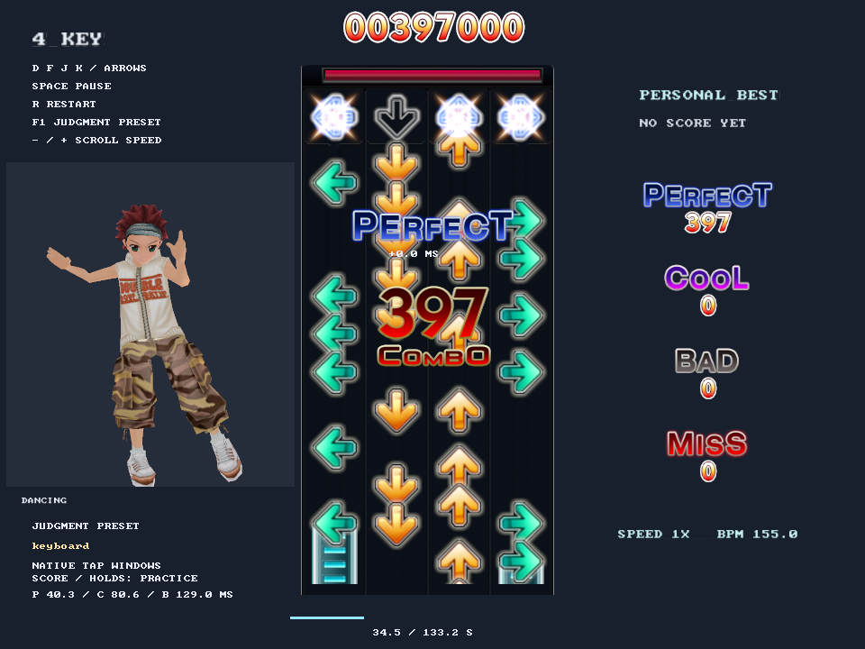
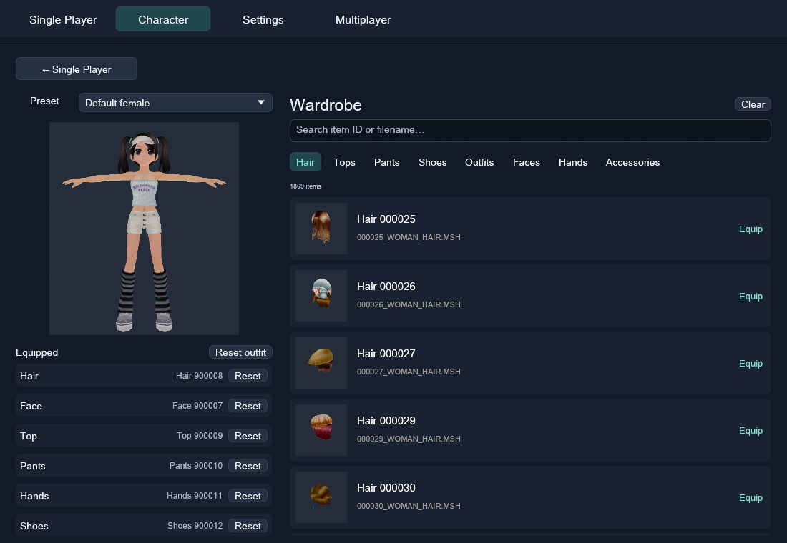
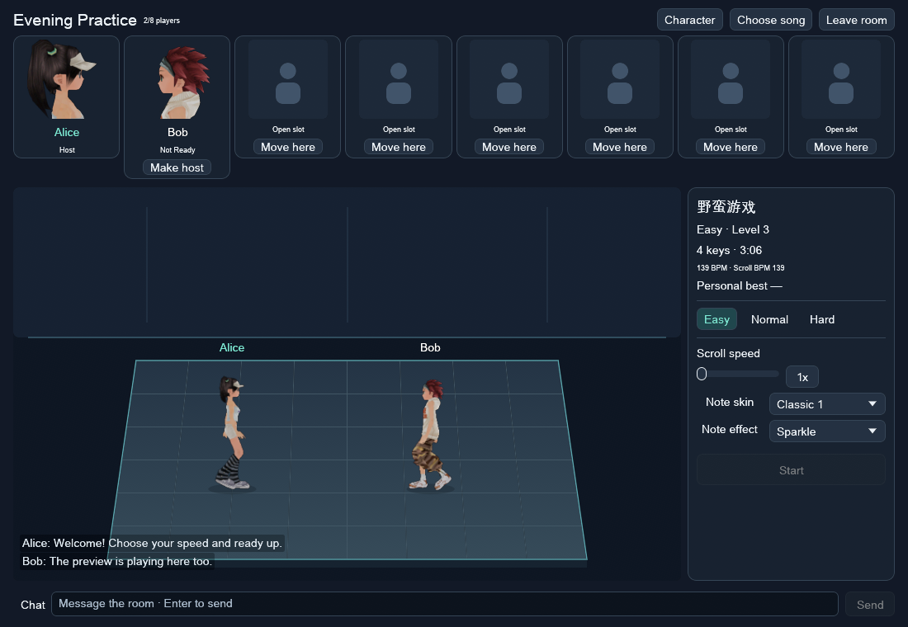
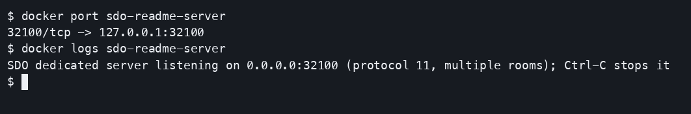

# SDO Arrowgene
> 100% AI-developed.

SDO Arrowgene aims to faithfully recreate the core rhythm gameplay of the *Super Dancer Online* series. It supports **four-key mode only**.

| Feature | What you can do |
| --- | --- |
| Single player | Play songs offline at your chosen difficulty. |
| Multiplayer | Host a room or join friends for a round. |
| Dedicated hosting | Run a standalone server with multiple rooms. |
| Wardrobe | Customize your dancer’s outfit in the **Character** tab. |

> [!IMPORTANT]
> **No game assets are included.** Each player needs a compatible asset folder.

To get started, download the [client for your platform](https://github.com/sebastian-heinz/sdo-arrowgene/releases/latest), extract it, and open `sdo-arrowgene`. In **Settings → Asset Folder**, select your folder and click **Reload assets**.

The downloadable Linux x86-64 binaries target glibc 2.35 (Ubuntu 22.04). Run `getconf GNU_LIBC_VERSION` to check your system.

## Single player

Open **Single Player**, choose a song and difficulty, and press <kbd>Enter</kbd> to play offline. Use <kbd>D</kbd> <kbd>F</kbd> <kbd>J</kbd> <kbd>K</kbd> or the arrow keys to hit notes in the four lanes.

| Four-key gameplay | Character wardrobe |
| :---: | :---: |
|  |  |

## Browser player

Run the dedicated server with both options to play from its asset collection.

```sh
sdo-server --web --assets ./assets
```

Open `http://localhost:32101/play/` on the server machine, or substitute its hostname from another device. Select a four-key track and difficulty to play solo. The browser runs the Rust client used on desktop, including the 3D dancer and wardrobe. To play online, select **Multiplayer → Join Server**, connect, join an existing room, then choose **Ready**. The host selects the chart and starts the round.

| Option | What it serves |
| --- | --- |
| `--web` | The built-in player at `/play/` and its WebSocket at `/play/ws`. Players can enter a separate asset server URL. |
| `--assets DIRECTORY` | The song and character manifests and their content-addressed files over HTTP. Combine with `--web` to load this collection automatically. |
| `--asset-listen HOST:PORT` | The shared HTTP listener, default `0.0.0.0:32101`. Native clients use the separate game TCP listener on port `32100`. |

For Docker, publish `32101/tcp`, mount the collection read-only, and pass the options after the image name. Also publish `32100/tcp` for desktop players.

### Reverse proxy

For a public URL such as `https://arrowgene.com/subdir/play/`, forward `/subdir/` to the server's HTTP listener, stripping `/subdir/` and forwarding WebSocket upgrades. The browser resolves the client, local assets, and room socket relative to the player URL. HTTP uses `ws://` and HTTPS uses `wss://`. The upstream connection can use HTTP in both cases. When exposing the player directly at `/subdir/`, map that prefix to the upstream `/play/` directory and redirect `/subdir` to `/subdir/`.

The browser bundle is embedded in the server binary. To rebuild it after changing the client, platform adapters, or decoding worker, install the `wasm32-unknown-unknown` Rust target and `wasm-bindgen-cli` 0.2.130, run `sh web/build.sh`, then rebuild `sdo-server`.

## Multiplayer

- **Host a room** from the client under **Multiplayer → Host Server**.
- **Join a room** through **Multiplayer → Join Server**. Enter the host’s address, such as `192.168.1.20:32100` on a LAN.

Each player needs matching song and chart data. Players using an asset server fetch missing files when they ready up.



## Scoring

Each Perfect earns 50 points, each Cool earns 40, each Bad earns 20, and each Miss deducts 10. Each note in your longest combo adds another 18 points.

```text
base score = 50 × Perfect + 40 × Cool + 20 × Bad − 10 × Miss + 18 × max combo
```

Perfect and Cool extend your combo. Bad and Miss break it. For example, a Cool earns 58 when it sets a new longest combo and 40 while you rebuild a streak, including the hit that ties your previous best. The displayed score has a minimum of zero. Earlier Misses still count when you earn points later.

In a multiplayer round that starts with four players, finishers with distinct base scores receive a placement bonus on the results screen. First place earns 4%, second 3%, third 2%, and fourth 1%. The game rounds down to whole points. For example, a first-place base score of 20,710 becomes 21,538. Players who fail or forfeit keep their base score. If any finishers tie, everyone keeps their base score. Single player and other room sizes also use the base score. These bonus rules reflect the available US match captures.

Single-player personal bests use the local history in `score.json`. Multiplayer personal bests use `multiplayer-scores.json`, which records your final server-awarded points, including any placement bonus, when you finish a round.

## Judgment zones

Keyboard and Pad use 48 timing ticks per beat. The table shows the absolute difference between the input tick and the note tick, with both ends of each range included.

| Preset | Perfect | Cool | Bad | Miss |
| --- | ---: | ---: | ---: | ---: |
| Keyboard | 0–5 | 6–10 | 11–16 | 17–20 |
| Pad | 0–6 | 7–15 | 16–20 | 21–25 |

One tick lasts `60,000 / (48 × BPM)` milliseconds. At 120 BPM, six ticks span 62.5 ms. A six-tick error earns a Cool on Keyboard and a Perfect on Pad. The game truncates the input time to a whole tick, so early and late boundaries can differ by part of a tick. A press outside the Miss zone leaves that note pending if it is still upcoming. An unplayed note becomes a Miss once its late window expires.

For a hold, the game judges the press and release separately using the tempo at each end. The worse of the two judgments counts once toward your score and combo.

## Docker hosting

The standalone server hosts multiple rooms. It listens on TCP port `32100` and runs without game assets.

```sh
docker run --rm --init -p 32100:32100 ghcr.io/sebastian-heinz/sdo-server:latest
```

Open **Multiplayer → Join Server** and enter `localhost:32100` if you’re playing on the server machine. From another computer, enter the host’s IP address or hostname followed by `:32100`. Once connected, create or join a room.



For a local build, run `docker build -t sdo-server .` and use `sdo-server` as the image name.
